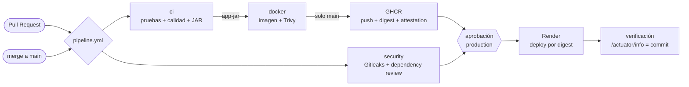

# TaskFlow API — de cero a producción con CI/CD

[](https://github.com/Rabedon1/taskflow-api/actions/workflows/pipeline.yml)
[](LICENSE)

API REST de tareas en **Spring Boot**. El verdadero protagonista del proyecto es el **pipeline CI/CD**, construido paso a paso con **GitHub Actions**. Cada cambio pasa por pruebas, controles de calidad y escaneos de seguridad. Después se empaqueta **una sola vez** en una imagen Docker, se publica en **GHCR** con firma de procedencia y, tras una aprobación manual, se despliega **por digest** en **Render**, con la base de datos en **Neon**. Al final, el pipeline verifica que producción corre el commit exacto.

**En vivo:** https://taskflow-api-main.onrender.com/swagger-ui.html. El plan gratuito se duerme sin uso, así que la primera visita puede tardar unos 60 segundos.

## El pipeline



| Evento | Qué corre | Qué **no** corre |
|---|---|---|
| Pull Request a `main` | Pruebas, calidad, Gitleaks, dependency review, construcción y escaneo de la imagen | Publicar y desplegar: un PR nunca llega a producción |
| Merge a `main` | Todo lo anterior + publicación en GHCR + attestation + deploy (con aprobación) + verificación | dependency review (solo compara cambios de un PR) |
| Manual (`workflow_dispatch`) | **Rollback / redeploy** de un digest ya publicado | Compilar, probar o reconstruir: la imagen ya pasó por todo eso |

Garantías del diseño:

- **Construir una vez, promover el digest.** El JAR que pasó las pruebas es el que va en la imagen, y la imagen escaneada es la que se despliega, identificada por su `sha256`.
- **`main` protegida.** Ningún cambio entra sin PR y sin checks en verde.
- **Mínimo privilegio.** El `GITHUB_TOKEN` es de solo lectura, salvo en el job que publica, y las Actions están fijadas por SHA completo.
- **Secretos fuera del repositorio.** Las credenciales de Neon viven solo en Render, y el deploy hook es un secreto del environment `production`.
- **Trazabilidad.** La imagen lleva labels OCI con el commit, tiene una attestation SLSA verificable, y `/actuator/info` expone el commit que corre en producción.

## Stack

Java 17 · Spring Boot 4.2 · PostgreSQL 17 · Flyway · JUnit 5 + Mockito + Testcontainers · Spotless · SpotBugs · JaCoCo · Docker · GitHub Actions · GHCR · Trivy · Gitleaks · Dependabot · Render · Neon

## Ejecutar en local

Requisitos: JDK 17 y Docker Desktop.

```bash
./mvnw verify                      # pruebas unitarias + integración + calidad (igual que en CI)
./mvnw package -DskipTests         # genera el JAR
docker compose up --build          # API (perfil prod) + PostgreSQL
```

Después abre http://localhost:8080/swagger-ui.html y, para la versión desplegada, http://localhost:8080/actuator/info.

Para desarrollar sin Docker para la API:

```bash
docker compose up -d postgres
./mvnw spring-boot:run -Dspring-boot.run.profiles=local
```

## API

| Método | Ruta | Descripción |
|---|---|---|
| `POST` | `/api/v1/tasks` | Crear una tarea (201 + `Location`) |
| `GET` | `/api/v1/tasks?status=&page=&size=` | Listar con paginación (máximo 100 por página) |
| `GET` | `/api/v1/tasks/{id}` | Obtener una tarea |
| `PUT` | `/api/v1/tasks/{id}` | Actualizar una tarea |
| `DELETE` | `/api/v1/tasks/{id}` | Eliminar una tarea (204) |
| `GET` | `/actuator/health`, `/actuator/info` | Estado y commit desplegado |

Los errores siguen el formato **RFC 9457** (`application/problem+json`).

## Documentación

| Documento | Contenido |
|---|---|
| [docs/pipeline-flow.md](docs/pipeline-flow.md) | Cada etapa del pipeline: qué hace, por qué y qué pasaría si no |
| [docs/architecture.md](docs/architecture.md) | Arquitectura de la aplicación, perfiles y estrategia de pruebas |
| [docs/tooling.md](docs/tooling.md) | Todas las herramientas de testing, calidad y seguridad, y los ajustes de GitHub |
| [docs/github-setup.md](docs/github-setup.md) | Crear el repositorio, proteger `main` y la demo del PR bloqueado |
| [docs/deployment.md](docs/deployment.md) | Configurar Neon, Render y el environment `production`, y hacer rollback |

## Evidencias

| | |
|---|---|
| **Pipeline completo en verde** |  |
| **PR con una prueba rota: merge bloqueado** |  |
| **Trivy bloquea una actualización con 16 CVE altos** |  |
| **Aprobación manual del despliegue** |  |
| **Verificación: producción corre el commit del merge** |  |
| **`/actuator/info` en producción** |  |

## Licencia

[MIT](LICENSE) © 2026 Rabedon1
