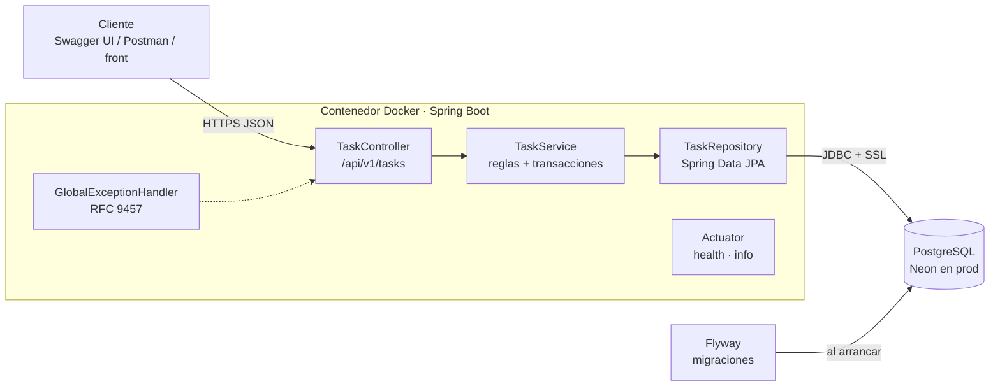

# Arquitectura de la aplicación

La aplicación es deliberadamente simple: un CRUD de tareas. La complejidad del proyecto vive en el pipeline, pero la app sigue las prácticas de un servicio real.

## Vista general



## Capas (paquete `io.github.rabedon1.taskflow`)

| Capa | Clase | Responsabilidad |
|---|---|---|
| Web | `task/TaskController` | HTTP: rutas, códigos de estado, `Location` en el 201 y validación con `@Valid` |
| DTO | `task/dto/TaskRequest`, `TaskResponse`, `PageResponse` | El contrato JSON. La entidad nunca se expone directamente |
| Servicio | `task/TaskService` | Reglas de negocio (estado por defecto `TODO`, recorte del título) y transacciones |
| Persistencia | `task/TaskRepository` | Acceso a datos con Spring Data JPA (`findByStatus` con paginación) |
| Dominio | `task/Task`, `TaskStatus` | La entidad JPA y sus fechas automáticas (`@PrePersist`, `@PreUpdate`) |
| Errores | `common/GlobalExceptionHandler` | Traduce las excepciones a respuestas RFC 9457 |

El código se organiza **por funcionalidad** (`task/`) y no por tipo técnico (`controllers/`, `services/`). Todo lo de "tareas" vive junto. Si mañana se agrega `user/`, sería una carpeta nueva que no toca la existente.

**Por qué DTOs y no la entidad directa:** si el JSON fuera la entidad, cambiar una columna rompería el contrato de la API, y un cliente podría enviar campos que no debería controlar, como `id` o `createdAt`. Los DTOs separan "cómo se guarda" de "qué se expone".

## Modelo de datos

Lo crea Flyway en `V1__create_tasks.sql`:

| Columna | Tipo | Regla |
|---|---|---|
| `id` | UUID | Clave primaria, generada por la app |
| `title` | VARCHAR(120) | Obligatorio |
| `description` | VARCHAR(1000) | Opcional |
| `status` | VARCHAR(20) | `TODO`, `IN_PROGRESS` o `DONE` (con `CHECK` en la base) |
| `due_date` | DATE | Opcional |
| `created_at`, `updated_at` | TIMESTAMPTZ | Automáticas |

**Por qué Flyway y `ddl-auto: validate`:** el esquema se define en migraciones SQL versionadas, revisables en un PR y aplicadas igual en todos los entornos. Hibernate solo **valida** que las entidades coincidan con el esquema. Si no coinciden, la app no arranca, en vez de "arreglar" la tabla de producción por su cuenta.

## Errores (RFC 9457)

Todas las respuestas de error usan `application/problem+json`:

```json
{
  "type": "about:blank",
  "title": "Validation error",
  "status": 400,
  "detail": "Request validation failed",
  "instance": "/api/v1/tasks",
  "errors": [{ "field": "title", "message": "must not be blank" }]
}
```

| Situación | Respuesta |
|---|---|
| Campos inválidos | 400 con la lista `errors` |
| JSON mal formado | 400 "Malformed request" |
| Parámetro con tipo inválido (un UUID o un `status` mal escrito) | 400 "Invalid parameter" |
| La tarea no existe | 404 "Task not found" |
| Error inesperado | 500 con detail "Unexpected error". El detalle real solo va al log y **nunca se envía el stack trace** al cliente |

## Perfiles de configuración

| Perfil | Dónde | Base de datos | Credenciales |
|---|---|---|---|
| *(default)* | Configuración común | — | — |
| `local` | Tu PC (`spring-boot:run`) | `localhost:5432` (compose) | Fijas, solo para desarrollo |
| `prod` | Render y `docker compose` | Neon (o el Postgres de compose) | **Variables de entorno**, nunca en el repositorio |
| Pruebas | `*IT` | PostgreSQL en Testcontainers | Las genera Testcontainers |

El perfil `prod` ajusta el pool de conexiones a 5 (Neon gratis tiene pocas), espera hasta 60 segundos a la base al arrancar por los arranques en frío y confía en los headers del proxy de Render (`forward-headers-strategy`). La app escucha en `${PORT:8080}`, porque Render inyecta `PORT`.

## Observabilidad mínima

Actuator expone **solo** `health` e `info`:

- `/actuator/health` incluye los grupos `liveness` y `readiness`. Render usa `readiness` para decidir cuándo mandar tráfico a la versión nueva.
- `/actuator/info` muestra el commit (`git.commit.id.full`) y los datos del build. El pipeline lo usa para verificar el despliegue.
- Endpoints como `/actuator/env` o `/actuator/beans` **no están expuestos**, porque revelarían configuración interna. Hay una prueba que lo garantiza.

## Estrategia de pruebas

| Tipo | Sufijo · plugin | Qué prueba | Velocidad |
|---|---|---|---|
| Unitarias | `*Test` · Surefire | `TaskService` con Mockito y `TaskController` con `@WebMvcTest` (validaciones, códigos HTTP, formato de errores) | Milisegundos |
| Integración | `*IT` · Failsafe | Repositorio, migraciones y API completa contra **PostgreSQL real** (Testcontainers), además de Actuator | Segundos |

**Por qué Testcontainers y no H2:** H2 es una base en memoria que *imita* a PostgreSQL, pero no es PostgreSQL. Tipos como `TIMESTAMPTZ`, los `CHECK` y el SQL de las migraciones de Flyway pueden comportarse distinto. Una prueba verde en H2 no garantiza que funcione en Neon. Testcontainers levanta un PostgreSQL 17 real en Docker, la misma versión de producción, y lo destruye al terminar. Así, lo que pasa en las pruebas es lo que pasa en producción.

La cobertura mínima es del **80 % de líneas**, medida por JaCoCo sumando unitarias e integración. Si baja, el build falla.
