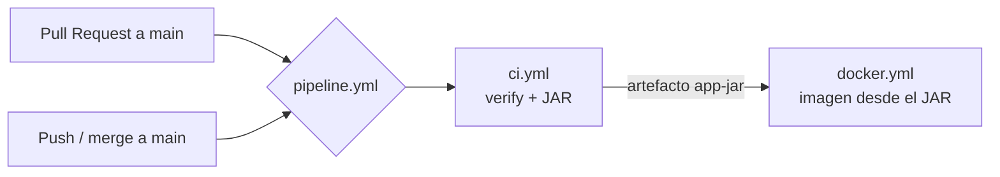

# Flujo del pipeline

Este documento explica **qué** hace cada parte del pipeline, **por qué** está diseñada así y **qué pasaría si no**. Se va completando etapa por etapa.

## Vista general



| Archivo | Tipo | Responsabilidad |
|---|---|---|
| `.github/workflows/pipeline.yml` | Orquestador | Decide qué etapas corren según el evento y las encadena |
| `.github/workflows/ci.yml` | Reutilizable (`workflow_call`) | Pruebas, calidad y empaquetado del JAR |
| `.github/workflows/docker.yml` | Reutilizable (`workflow_call`) | Construir la imagen **una vez** con el JAR de CI |

---

## 1. El orquestador y los workflows reutilizables

GitHub Actions ejecuta **workflows**: archivos YAML en `.github/workflows/`. Cada workflow tiene **disparadores** (`on:`) y **jobs**. Un job corre en una máquina virtual nueva (un *runner*) y ejecuta **steps** en orden.

Un **workflow reutilizable** declara `on: workflow_call` y no se dispara solo: otro workflow lo invoca como si fuera una función, con `uses: ./.github/workflows/ci.yml`.

**¿Por qué un orquestador más workflows reutilizables?**

- **Una responsabilidad por archivo.** `ci.yml` solo sabe probar y empaquetar. No sabe nada de Docker ni de Render. Si mañana cambias de proveedor de despliegue, `ci.yml` no se toca.
- **Una sola ejecución visible.** En la pestaña *Actions*, un PR o un merge aparece como **un** run con todas sus etapas encadenadas en un grafo. La alternativa (workflows independientes que se disparan entre sí con `workflow_run`) produce varias ejecuciones separadas, difíciles de seguir. Además, `workflow_run` siempre corre con el código de `main` y no con el del PR, lo que trae sorpresas.
- **Datos que viajan limpios.** Las etapas se pasan información con `inputs` y `outputs`, como parámetros de una función. Así viajará el *digest* de la imagen hasta el despliegue.

## 2. Disparadores: qué corre y cuándo

| Evento | Qué significa | Qué corre hoy |
|---|---|---|
| `pull_request` → `main` | Alguien propone integrar cambios | CI + construir imagen (sin tag `main`) |
| `push` → `main` | Los cambios ya se integraron (merge) | CI + construir imagen (tags `sha-<7>` y `main`) |
| `workflow_dispatch` | Ejecución manual desde la UI o `gh` | CI + construir imagen (más adelante: redeploy/rollback) |

En las etapas siguientes, publicar la imagen y desplegar solo correrá en `push` a `main`. **Un PR nunca publica ni despliega:** es código que todavía no fue aprobado.

## 3. Etapa CI (`ci.yml`)

```
checkout → setup-java (+caché) → ./mvnw verify → subir JAR → subir reportes
```

### `./mvnw verify`: el mismo comando en local y en CI

El pipeline **no** reimplementa las verificaciones en YAML: llama al mismo comando que corres en tu máquina. `verify` ejecuta, en este orden:

1. Compilación.
2. **Pruebas unitarias** (`*Test`, Surefire): lógica aislada con Mockito, en milisegundos.
3. Empaquetado del JAR.
4. **Pruebas de integración** (`*IT`, Failsafe): PostgreSQL real con Testcontainers. Los runners `ubuntu-latest` ya traen Docker, así que funcionan sin configuración extra.
5. **Spotless** (formato), **SpotBugs** (bugs comunes) y **JaCoCo** (cobertura ≥ 80 %).

Si cualquier paso falla, el comando devuelve un código distinto de 0 y el job queda en rojo.

> **Si no fuera así:** con controles definidos solo en el YAML, descubrirías los errores recién al hacer push, y "en mi máquina funciona" volvería a ser un problema.

### Caché de Maven

`setup-java` con `cache: maven` guarda `~/.m2` entre ejecuciones, con una clave basada en el `pom.xml`. La primera ejecución descarga todas las dependencias; las siguientes las reutilizan. Esto reduce minutos por run.

### El JAR como artefacto: la semilla de "construir una vez"

Al terminar, el job sube `target/taskflow-api-*.jar` como **artefacto** `app-jar`. En la etapa Docker, la imagen se construirá copiando **este** JAR: el mismo binario que pasó todas las pruebas. No se recompila.

> **Si no fuera así:** si cada etapa recompilara, el binario desplegado no sería exactamente el que se probó (otra versión de una dependencia resuelta en otro momento, otra JVM, etc.). "Construir una vez y promover" elimina esa duda.

Los reportes de pruebas y cobertura se suben con `if: always()`: también, y sobre todo, cuando algo falla, para poder descargar el reporte y ver *por qué* falló.

## 4. Etapa Docker (`docker.yml`)

```
checkout → descargar app-jar → Buildx → metadata (tags) → build (load) → comprobar usuario y labels
```

### Construir una vez, a partir del JAR de CI

El job `docker / build` **no compila**: descarga el artefacto `app-jar` que subió `ci / verify` y lo copia dentro de la imagen. `needs: ci` garantiza el orden: si las pruebas fallan, la imagen ni siquiera se construye.

> **Si no fuera así:** con un Dockerfile multi-stage que compila por su cuenta, la imagen llevaría un binario que nunca pasó las pruebas. Casi siempre sería idéntico, pero "casi" no es una garantía.

### Tags y digest

| Referencia | Ejemplo | ¿Cambia? | Uso |
|---|---|---|---|
| Tag `sha-<7>` | `ghcr.io/rabedon1/taskflow-api:sha-e017916` | No en la práctica, porque un commit nunca se reconstruye | Saber qué commit es una imagen |
| Tag `main` | `ghcr.io/rabedon1/taskflow-api:main` | **Sí**: apunta a lo último integrado | Comodidad para humanos |
| Digest | `ghcr.io/rabedon1/taskflow-api@sha256:9f2c…` | **Nunca**: es la huella del contenido | **El despliegue** |

Un tag es una etiqueta que se puede despegar y pegar en otra imagen. El digest es el hash del contenido: si cambia un byte, cambia el digest. Por eso Render desplegará **por digest**: corre exactamente la imagen que se probó, se escaneó y se aprobó, aunque alguien vuelva a usar el tag `main` en otra imagen.

En un PR el tag `main` no se genera (`enable=${{ inputs.push }}`). Un PR nunca debe hacerse pasar por "lo que está en main".

### Labels con valores reales

El Dockerfile declara los labels OCI y el workflow les pasa los valores reales como `build-args`: `GIT_SHA` es el commit del run y `BUILD_DATE`/`VERSION` vienen de `metadata-action`. El último step verifica dos cosas sobre la imagen: que **no corre como root** y que el label `revision` **coincide con el commit**. Si algo de esto se rompiera en un cambio futuro, el pipeline lo detendría.

### Caché de capas

`cache-from/cache-to: type=gha` guarda las capas en la caché de GitHub Actions. La capa de Java (unos 300 MB) se reutiliza entre runs, y solo se reconstruye la capa del JAR.

### Cómo viajan los datos entre workflows

Un workflow reutilizable funciona como una función: recibe `inputs` y devuelve `outputs`. El valor sube por tres niveles:

```
step (echo "tag=..." >> $GITHUB_OUTPUT)
  → job      outputs: tag: ${{ steps.ref.outputs.tag }}
  → workflow outputs: tag: value: ${{ jobs.build.outputs.tag }}
  → pipeline.yml lo lee como ${{ needs.docker.outputs.tag }}
```

Con este mismo camino, en la etapa de publicación viajará el **digest** desde `docker.yml` hasta el job de despliegue.

## 5. Buenas prácticas de seguridad aplicadas

### Acciones fijadas por SHA completo

```yaml
uses: actions/checkout@3d3c42e5aac5ba805825da76410c181273ba90b1 # v7.0.1
```

Un tag como `@v7` es **mutable**: quien controle ese repositorio, o un atacante que lo comprometa, puede moverlo a otro código. Tu pipeline ejecutaría ese código nuevo con acceso a tus secretos, sin que cambies una línea.

Esto ocurrió en marzo de 2025 con `tj-actions/changed-files`: se reescribieron sus tags para apuntar a código malicioso que imprimía los secretos de miles de repositorios en los logs.

Un **SHA de commit** es inmutable: identifica un contenido exacto. El comentario `# v7.0.1` es para humanos. Dependabot (etapa 4) actualizará SHA y comentario juntos cuando salgan versiones nuevas.

### Permisos mínimos del `GITHUB_TOKEN`

Cada job recibe automáticamente un token, `GITHUB_TOKEN`, para hablar con la API de GitHub. Por defecto puede tener permisos amplios, como escribir en el repositorio.

```yaml
permissions:
  contents: read
```

Así, el token solo puede **leer** el código. Si un paso fuera comprometido (por ejemplo, una dependencia maliciosa ejecutándose durante las pruebas), no podría hacer push, crear releases ni publicar paquetes. Los jobs que necesiten más, como publicar en GHCR, lo pedirán **explícitamente y solo para ellos**.

También usamos `persist-credentials: false` en el checkout, para que el token no quede guardado en `.git/config`, donde cualquier paso posterior podría leerlo.

### `concurrency`

```yaml
concurrency:
  group: pipeline-${{ github.ref }}
  cancel-in-progress: ${{ github.event_name == 'pull_request' }}
```

- **En un PR**, si haces otro push mientras el pipeline anterior sigue corriendo, el anterior se cancela. Su resultado ya no importa y ahorras minutos.
- **En `main` no se cancela nada.** Cada merge tiene que terminar su recorrido completo. Más adelante, eso incluye el despliegue, y cancelar un despliegue a medias es peligroso.

### Validación local de los workflows

Los YAML se validan antes de subirlos con [actionlint](https://github.com/rhysd/actionlint), que detecta errores de sintaxis, expresiones mal escritas (`github.evnt_name`) y problemas de shell:

```bash
docker run --rm -v "${PWD}:/repo" -w /repo rhysd/actionlint:latest -color
```
