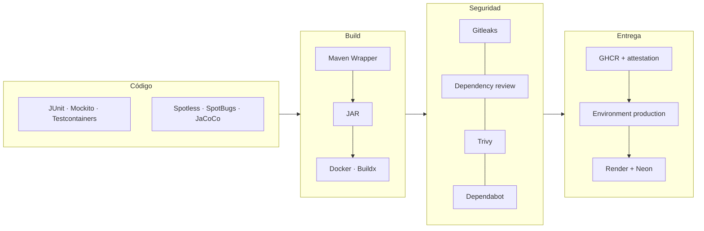

# Herramientas del proyecto: qué es cada una y por qué está

Este documento recorre **todas** las herramientas de testing, calidad, build, contenedores, seguridad y despliegue del proyecto, más los ajustes de GitHub que el pipeline necesita. Para cada una explica qué hace, por qué se eligió y qué pasaría sin ella.

---

## 1. Testing

| Herramienta | Qué es | En este proyecto |
|---|---|---|
| **JUnit 5** | El framework estándar de pruebas en Java | Todas las pruebas (`@Test`) |
| **AssertJ** | Aserciones legibles (`assertThat(x).isEqualTo(y)`) | Todas las comprobaciones |
| **Mockito** | Crea "dobles" falsos de una dependencia | `TaskServiceTest` simula el repositorio para probar solo la lógica, sin base de datos |
| **Spring Boot Test** (`@WebMvcTest`) | Levanta solo la capa web | `TaskControllerTest` prueba rutas, validaciones, códigos HTTP y el formato de los errores |
| **Testcontainers** | Arranca contenedores Docker reales desde una prueba | Un **PostgreSQL 17 real** para los `*IT`, que se destruye al terminar |
| **Surefire** | Plugin de Maven que ejecuta las pruebas unitarias | Corre `*Test` en la fase `test` |
| **Failsafe** | Plugin de Maven que ejecuta las pruebas de integración | Corre `*IT` en `integration-test` y falla en `verify` |

**La pirámide de pruebas:** muchas unitarias (19), rápidas y aisladas, y menos de integración (10), más lentas pero reales. Las unitarias encuentran errores de lógica en milisegundos. Las de integración prueban que las piezas funcionan **juntas**: SQL real, migraciones, JSON y HTTP.

**Por qué Surefire y Failsafe son plugins distintos:** si una prueba de integración falla, Failsafe igual deja terminar la fase `post-integration-test`, para que se puedan apagar contenedores y servidores. Recién después, en `verify`, marca el build como fallido. Surefire cortaría el build de golpe.

**Por qué Testcontainers y no H2:** H2 *imita* a PostgreSQL. Testcontainers *es* PostgreSQL. Ver [architecture.md](architecture.md#estrategia-de-pruebas).

**Prueba del script de despliegue:** `scripts/test-verify-deploy.sh` prueba `verify-deploy.sh` contra la app real en compose, con tres casos: commit correcto, commit incorrecto y servidor caído.

## 2. Calidad de código (*quality gates*)

Un ***quality gate*** es un control que **rompe el build** si no se cumple. No es una recomendación: si falla, el PR no entra.

| Herramienta | Qué revisa | Cuándo falla |
|---|---|---|
| **Spotless** (google-java-format) | El formato: indentación, espacios, imports sin usar | Si el código no está formateado. Se arregla con `./mvnw spotless:apply` |
| **SpotBugs** | Análisis estático del bytecode: posibles `NullPointerException`, recursos sin cerrar, comparaciones incorrectas… | Si encuentra un bug de prioridad alta |
| **JaCoCo** | Cobertura: qué porcentaje de las líneas ejecutaron las pruebas | Si la cobertura total (unitarias + integración) baja del **80 %** |

**Por qué un formato automático:** sin él, los PRs se llenan de cambios de espacios que esconden los cambios reales, y las revisiones se van en discusiones de estilo. Con Spotless, el formato no se discute: lo decide una herramienta.

**Por qué el 80 % y no el 100 %:** el 100 % obliga a escribir pruebas sin valor solo para cubrir líneas triviales. El 80 % asegura que la lógica importante está probada. La cobertura dice **qué no se probó**, no que lo probado esté bien.

## 3. Build y empaquetado

| Herramienta | Qué hace | Por qué |
|---|---|---|
| **Maven Wrapper** (`./mvnw`) | Descarga y usa una versión **fija** de Maven | Todos (tú, CI, otro desarrollador) usan exactamente la misma versión. No hace falta instalar Maven |
| **spring-boot-maven-plugin** | Genera el JAR ejecutable y `build-info` | Un solo archivo con la app y todas sus librerías |
| **git-commit-id-maven-plugin** | Escribe `git.properties` dentro del JAR | `/actuator/info` muestra el commit, la base de la verificación del despliegue |
| **Flyway** | Aplica migraciones SQL versionadas al arrancar | El esquema de la base vive en el código y se aplica igual en todos los entornos |

`./mvnw verify` es **el mismo comando en tu PC y en CI**: compila, ejecuta las pruebas unitarias, empaqueta, ejecuta las de integración y pasa los quality gates.

## 4. Contenedores

| Herramienta | Qué hace | En este proyecto |
|---|---|---|
| **Docker** | Empaqueta la app con su sistema y su JVM en una **imagen** que corre igual en cualquier lugar | `docker/Dockerfile`: JRE 17 + el JAR, con un usuario no root |
| **Docker Compose** | Levanta varios contenedores juntos | `postgres` + `api` en local, con la misma configuración de producción |
| **Buildx** | El motor de build moderno de Docker | Caché de capas en GitHub Actions (`type=gha`) |
| **metadata-action** | Calcula tags y labels a partir del contexto de Git | Tags `sha-<7>` y `main`, y la fecha de creación |
| **Labels OCI** | Metadatos estándar dentro de la imagen | `source` (el repositorio), `revision` (el commit), `created` y `version` |

Decisiones clave: la imagen base va **fijada por digest**, corre con un **usuario no root** (uid 10001), usa `MaxRAMPercentage=75` para el contenedor de 512 MB, y el `.dockerignore` deja pasar **solo el JAR**. Los comentarios de `docker/Dockerfile` explican cada una.

## 5. CI/CD (GitHub Actions)

| Pieza | Qué es |
|---|---|
| **Workflow** | Un archivo YAML en `.github/workflows/` con disparadores (`on:`) y jobs |
| **Job** | Un conjunto de pasos que corre en una **máquina virtual nueva** (*runner*), que se destruye al terminar |
| **Step** | Un comando (`run:`) o una Action (`uses:`) |
| **Action** | Un paso reutilizable publicado por terceros, por ejemplo `actions/checkout` |
| **Workflow reutilizable** | Un workflow con `on: workflow_call`, que se invoca como una función con `inputs` y `outputs` |
| **Artefacto** | Archivos que un job sube y otro descarga. Es como pasa el JAR de `ci` a `docker` |
| **`GITHUB_TOKEN`** | Token automático de cada run, con **solo** los permisos declarados en `permissions:` |
| **`needs:`** | Dependencias entre jobs: `docker` espera a `ci`, y `deploy` espera a `docker` y a `security` |
| **`concurrency:`** | Evita ejecuciones simultáneas: cancela runs viejos en los PRs y nunca cancela un deploy |
| **actionlint** | Linter de los YAML de Actions. Detecta errores antes de hacer push |

Prácticas aplicadas: **Actions fijadas por SHA completo**, `permissions: contents: read` por defecto con permisos extra **solo** en el job que los necesita, y `persist-credentials: false` en cada checkout.

## 6. Seguridad de la cadena de suministro

La **cadena de suministro** es todo lo que entra en tu software sin que lo hayas escrito tú: librerías, imagen base, sistema operativo, Actions del pipeline. Cada eslabón es una puerta para un atacante. Casos reales: Log4Shell (2021) y tj-actions (2025).

| Herramienta | Pregunta que responde | Cuándo actúa |
|---|---|---|
| **Gitleaks** | ¿Hay contraseñas, tokens o claves en el código o en **cualquier commit** del historial? | En cada PR y en cada push a `main` |
| **Dependency review** | ¿Este PR **agrega** una librería con vulnerabilidades conocidas (CVE)? | Solo en PRs, comparando con `main` |
| **Trivy** | ¿La **imagen** (Ubuntu + JVM + librerías del JAR) tiene CVEs críticos o altos con parche? | Después de construirla y **antes** de publicarla |
| **SARIF + Code scanning** | ¿Dónde veo los hallazgos? | Trivy sube su reporte a la pestaña **Security → Code scanning** |
| **Dependabot** | ¿Hay versiones nuevas de dependencias, Actions o la imagen base? | Cada semana abre PRs, que pasan por todo el pipeline |
| **Attestation (SLSA)** | ¿Esta imagen salió de verdad de mi pipeline? | Al publicar. Se verifica con `gh attestation verify` |

Conceptos:

- **CVE:** el identificador público de una vulnerabilidad conocida, por ejemplo `CVE-2021-44228` (Log4Shell). Las herramientas comparan tus versiones contra bases de CVEs.
- **Por qué `ignore-unfixed`:** si un CVE no tiene parche, no hay nada que actualizar. Bloquear por él dejaría el pipeline rojo sin salida.
- **Por qué Gitleaks se descarga con checksum:** usar el binario oficial con versión y SHA-256 fijos evita depender de una Action de terceros más, justo el tipo de eslabón que falló en tj-actions.
- **Si se filtra un secreto:** borrarlo en un commit nuevo **no alcanza**, porque sigue en el historial. Hay que **rotarlo**, es decir, generar uno nuevo y revocar el viejo.
- **SLSA** (*Supply-chain Levels for Software Artifacts*): estándar que define niveles de confianza en cómo se construye un artefacto. Este proyecto genera procedencia firmada por la plataforma (nivel Build L2).

## 7. Registro y despliegue

| Plataforma | Rol | Por qué esta |
|---|---|---|
| **GHCR** (`ghcr.io`) | Almacén de imágenes Docker | Integrado con GitHub: se publica con el `GITHUB_TOKEN` del run, sin tokens personales |
| **Render** | Ejecuta el contenedor en internet | Plan gratis, despliega una imagen existente y tiene deploy hook con `imgURL` |
| **Neon** | PostgreSQL administrado | Plan gratis, PostgreSQL 17 real, SSL y suspensión automática cuando no se usa |
| **Spring Boot Actuator** | Endpoints `health` e `info` | Render decide el tráfico con `readiness`, y el pipeline verifica el commit con `info` |
| **springdoc-openapi** | Documentación interactiva de la API | `/swagger-ui.html` para probar la API desde el navegador |

## 8. Ajustes de GitHub (fuera del YAML)

Parte de la seguridad del pipeline **no está en los archivos del repositorio**: es configuración de GitHub. Sin estos ajustes, el YAML solo *avisa*. Con ellos, *obliga*.

### Ruleset `protect-main` (Settings → Rules)

| Regla | Qué hace | Sin ella |
|---|---|---|
| Require a pull request | Nadie hace push directo a `main`, ni el dueño | Se podría saltar todo el pipeline con un `git push` |
| Require status checks | El merge se bloquea hasta que los checks estén en verde | El pipeline sería solo un aviso: se podría integrar código roto |
| Require branches to be up to date | El PR se prueba contra la versión **actual** de `main` | Dos PRs que pasan por separado podrían romperse al combinarse |
| Block force pushes | Nadie reescribe el historial de `main` | Se podría borrar la evidencia de qué se desplegó |
| Restrict deletions | Nadie borra `main` | — |
| Bypass list vacía | Las reglas aplican a todos | El administrador podría saltárselas "solo esta vez" |

Checks obligatorios: `ci / verify`, `security / secret-scan`, `security / dependency-review` y `docker / build`.

### Advanced Security (Settings → Advanced Security)

| Ajuste | Para qué |
|---|---|
| **Dependency graph** | GitHub lee el `pom.xml` y arma la lista de todas las dependencias. **Sin él, `dependency-review` falla con `403 Forbidden`**, como pasó en este proyecto |
| **Dependabot alerts** | Avisa cuando una dependencia que **ya** usas recibe un CVE nuevo |
| **Dependabot security updates** | Abre automáticamente el PR con el parche |
| **Code scanning** | Muestra los reportes SARIF de Trivy en la pestaña Security |

### Environment `production` (Settings → Environments)

| Ajuste | Para qué |
|---|---|
| Required reviewers | El deploy espera una aprobación humana, y queda registrado quién aprobó y cuándo |
| Deployment branches: solo `main` | Ninguna otra rama puede desplegar |
| Secreto `RENDER_DEPLOY_HOOK_URL` | Solo lo lee un job **aprobado** de este environment, nunca un PR |
| Variable `APP_URL` | La URL pública que se verifica. Debe escribirse sin espacios: un espacio al final rompió la verificación en este proyecto |

### Paquete en GHCR (Packages → taskflow-api → Settings)

| Ajuste | Para qué |
|---|---|
| Visibilidad **Public** | Render descarga la imagen sin credenciales. Las imágenes nuevas nacen privadas |
| Vinculado al repositorio | Lo hace el label `org.opencontainers.image.source`. El paquete aparece en la página del repositorio |

### Email privado (Settings → Emails de tu cuenta)

| Ajuste | Para qué |
|---|---|
| Keep my email addresses private + correo `…@users.noreply.github.com` | Los commits públicos no exponen tu correo real |
| Block command line pushes that expose my email | GitHub rechaza un push con tu correo real por error |
